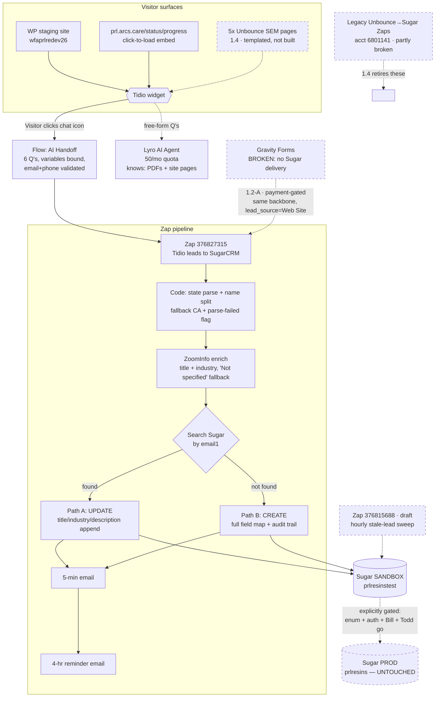
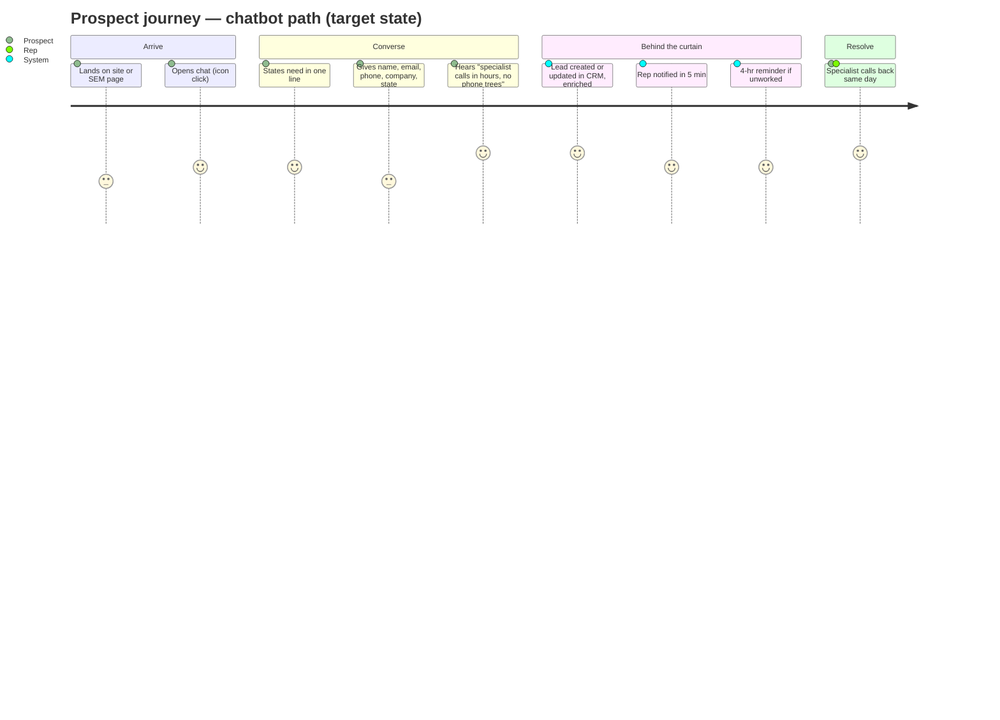
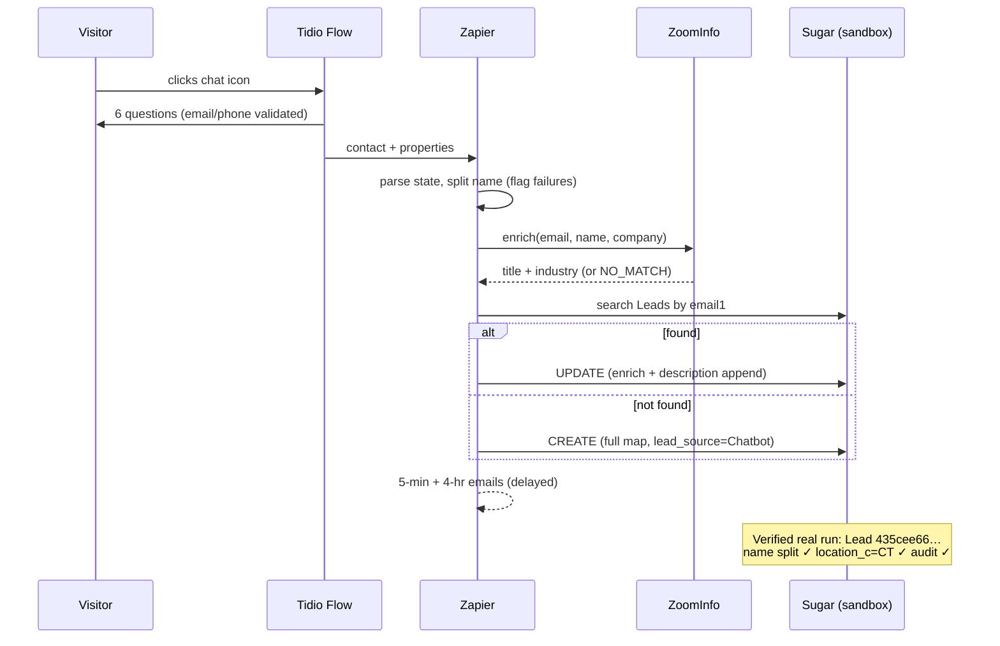

# PRL Chatbot Program — System SSOT (architecture · journeys · stories)

> Single source of truth for the build's shape as of 2026-08-18. Internal artifact — project
> outward (status pages, Todd decks) FROM this, never the reverse. Update this first when the
> architecture changes; the mermaid renders on GitHub natively.

## 1 · Build architecture (as deployed, sandbox scope)

**Known open defects (next session):** empty-email → dedup search matches arbitrary record →
Path A corrupts real leads (CRITICAL, filter fix queued); Roger Lamarre record repair; Lyro
resumes existing conversations instead of the flow; "Read more" citations on website sources.

## 2 · Customer journey (visitor's view)

**Journey failure modes mapped:** promise-with-no-delivery (the original sin — flow captured
nothing; FIXED) · wrong bot greets (trigger mismatch; FIXED) · misrouted rep (49% territory
mismatch; stopgap sweep + Bill call pending) · silent CA-lead (parse fallback; audit-trailed).

## 3 · Delivery sequence (the verified e2e path)

## 4 · User stories × phase (status = honest, per DoD reconciliation)

| # | As a… | I want… | So that… | Phase | Status |
|---|---|---|---|---|---|
| 1 | Prospect | to chat and be called back in hours | I don't fight a phone tree | 1.1 | ✅ staging-verified |
| 2 | Rep | complete, enriched leads in my CRM | I don't chase blanks | 1.1/1.2 | ✅ title/industry · ⏳ biz-email fill |
| 3 | Rep | a heads-up in 5 min + nudge at 4 hrs | leads don't go stale | 1.2 | ✅ built · ⏳ points at Zach not rep inbox |
| 4 | Todd | no duplicate leads on repeat visitors | pipeline data stays clean | 1.2 | ✅ built · ⚠️ empty-email edge = open bug |
| 5 | Todd | proof of what the chatbot adds | ROI is a number not a vibe | 1.2 | ⏳ baseline unblocked, not pulled |
| 6 | Todd | unassigned leads caught daily | routing gaps can't silently drop leads | stopgap | ⏳ SLA Zap draft |
| 7 | Sales mgr | routing that matches real territories | the right rep calls | Bill call | 🔒 gated |
| 8 | Prospect | web FORMS that actually deliver | any inbound path reaches a human | 1.2-A | 🔒 payment-gated, spec'd |
| 9 | Marketing | SEM pages with matched chat onramps | paid traffic converts + attributes | 1.4 | 📦 templated, not built |
| 10 | Todd | fewer questions asked of known contacts | less friction, same data | 1.3 | 💡 parked w/ caveats |

## 5 · Artifact registry — the doll manifest (internal vs external, explicit)

> Audience declarations for a future `scripts/doll_export.py` run (ADR-065 air-gap gate is
> fail-closed on `audience:` — this table is the prep; roll these values into frontmatter when
> exporting). EXTERNAL = Todd already sees it or safely could. INTERNAL = never ships raw;
> project a clean surface from it instead.

| Artifact | Audience | Why |
|---|---|---|
| prl.arcs.care/status/progress · /crm · /troubleshooting | EXTERNAL | built for Todd, live |
| public/todd-call.html + prl-chatbot.html (root pages) | EXTERNAL | the client SSOT pair |
| Stripe invoice #NYQRTJPQ-0004 + phase table | EXTERNAL | money surface |
| `prl-system-ssot.md` (this doc) §1–3 | PROJECTABLE | diagrams safe after pseudonym/detail scrub |
| `prl-system-ssot.md` §4 stories + defect notes | INTERNAL | honest-status framing is ours |
| `2026-08-18-dod-reconciliation.md` | INTERNAL | waiver/re-baseline ledger — summary only outward |
| `leg1-tidio-flow-map.md` + tidio-flows-baseline/ | INTERNAL | raw evidence, names Tidio internals |
| todd-routing-findings-report.html | EXTERNAL (already shared) | the /status/crm source |
| Routing sweep data (43-state, 49% mismatch detail) | INTERNAL until Bill call | per explicit sequencing decision |
| DEWY receipts (`_STATE/*.dewy.json`) | INTERNAL | decision provenance |
| sem-onramp-template/ (template + instances + runbook) | INTERNAL until 1.4 go | pre-scope work product |
| uat/ harness + fixtures | INTERNAL | test infrastructure |
| Zapier co-pilot briefs + meta-prompts | INTERNAL | operational tooling |
| Handoffs (CLAUDE.md vX.Y.Z) + memory files | INTERNAL | never export; contain cross-client context |

Rule of motion: content flows INTERNAL → EXTERNAL only through a deliberate projection (the
recoil-ship pattern), never by linking an internal file directly. A future doll export of the
"PRL engagement universe" = the EXTERNAL rows + PROJECTABLE rows post-scrub, nothing else.

## 6 · Source pointers (deeper truth lives here)
DoD ledger: `2026-08-18-dod-reconciliation.md` · flow map: `leg1-tidio-flow-map.md` · template:
`../../runtime/recoil/generated/prl-lyro/tidio-flows/sem-onramp-template/` · UAT harness:
`../../runtime/recoil/generated/prl-lyro/uat/` · receipts: `_STATE/2026-08-17-prl-1-1-session-
decisions.dewy.json` · client surfaces: prl.arcs.care/status/{progress,crm,troubleshooting}
