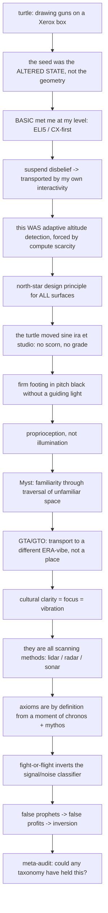

# Meta-Audit: Why Deductive Taxonomies Cannot Hold a Live Synthesis Thread

> **Specimen:** the closing sub-thread of session `cc50e305` (2026-08-01), running from a childhood
> memory of a turtle to a theory of state-aware perception. **Claim under test:** that a traditional,
> deductive personal-knowledge-management (PKM) system, starting from zero-point knowledge, cannot
> file this material without destroying the thing that makes it valuable. **Method:** reconstruct the
> real association graph, then attempt to file it in four canonical systems and observe the failure
> mode of each. Validates [[opposing-abductive-folksonomy-vs-taxonomy-overfit]] and
> [[tao-as-object-level-taxonomy-of-problem-space]] on live evidence rather than assertion.

---

## 1. ANALYZE — the specimen, as it actually moved

The thread did not proceed by decomposition (parent → child → child). It proceeded by **abductive
hop**: each node was reached by a resemblance to the previous one that was not predictable from any
category the previous one belonged to. The real sequence of moves:

The crucial structural fact: **the edges are the content.** The value is not in node J (Myst) or node
M (sonar); it is in the *hop* J→K→M that discovered "transport modalities are a sensor suite." A
system that stores the nodes and discards the edges has stored the ash and thrown away the fire.

Second structural fact: **the organizing categories did not pre-exist the thread — they were minted
by it.** "Sensor suite (lidar/radar/sonar)" (M) is the parent that retroactively organizes E, H, J,
K, L — but it did not exist until node M, which was the *fourteenth* move. A deductive system needs
the category *before* it can file the members. This thread produced the category *from* the members,
last.

---

## 2. ASSESS — file it in four traditional systems, from a cold start

Each system is given the nodes above and asked, with **zero prior knowledge** of this person or
project, to file them so the material is retrievable and its structure preserved.

### (a) Hierarchical taxonomy (Dewey / a folder tree / a class hierarchy)
A tree demands each item have **exactly one parent**. Where does node G, *"the turtle moved sine ira et
studio"*, go?
- It is a fact about **pedagogy** (non-judgmental instruction).
- It is a claim about **brand/UX** (render at altitude without condescension).
- It is **Roman historiography** (Tacitus, *Annals* I.1).
- It is **neuroscience-adjacent** (the NOTOMATION no-override constraint).
- It is **product law** (a design test for every surface).
A tree forces you to pick one and demote the other four to "see also" — which severs exactly the
cross-domain edges that were the insight. **Failure mode: single-parent amputation.** The tree cannot
even represent that G is *simultaneously* five things; it can only pick a winner and lie by omission.

### (b) Flat tag system (Obsidian tags, Gmail labels, del.icio.us)
Tags fix the single-parent problem — G can be tagged `#pedagogy #brand #rome #neuro #product`. But
tags must be **known in advance to be useful**, and from a cold start you do not have the vocabulary.
You would never pre-declare a `#sensor-suite` tag before node M invents it, so nodes E, H, J, K, L get
tagged with whatever words were available *at the time* (`#altitude`, `#fog`, `#myst`, `#vibe`) — and
the unifying tag that makes them one thing arrives too late and never back-propagates. **Failure mode:
vocabulary cold-start.** Tags can only describe categories you already have; this thread's payload was
the categories you *didn't* have yet.

### (c) Zettelkasten / linked-note PKM (Luhmann, Roam, a wiki)
This is the strongest contender — it is a graph, it permits many links, it prizes surprising
connections. It would capture the *nodes* well. But Zettelkasten links are **laid by hand, after the
fact, at leisure.** The thread laid ~15 load-bearing edges in a single unbroken session at synthesis
speed, several of them (J→K, M→N, O→P) genuinely novel — not retrievals of existing links but
*minting* of new ones. A Zettelkasten records connections you have already made; it has no mechanism
for the *live abductive leap* itself, and no way to know that edge J→K→M is worth more than the fifty
mundane edges around it. **Failure mode: post-hoc, un-weighted, and slow.** It is a beautiful
crematorium for insights that have already cooled — not a hearth.

### (d) Relational schema (a `notes` table, foreign keys, a fixed ontology)
A DBA asked to model this cold would need the entity types *before* seeing the data: `Concept`,
`Domain`, `Source`. But node N ("axioms come from chronos + mythos") is an entity that is *about the
schema itself* — it asserts that first-principles carry their origin-moment, which is a claim no
`Concept` row can hold without a self-referential `Concept-about-Concepts` type the designer could not
have anticipated. And node M mints a *new domain* (perception-as-scanning) that has no table. Every
genuinely new node is a `ALTER TABLE`. **Failure mode: the schema must change on almost every insert**,
which is the definition of a schema that does not fit the domain.

---

## 3. EVALUATE — the common root of all four failures

The four systems fail differently on the surface but identically at the root. Every one of them is
**deductive**: it requires the category to exist *before* the member can be placed. Its cold-start
posture is "here is my ontology; show me your data and I will slot it in."

This thread is **abductive**: it generates the category *from* the member, and often generates it
*many moves later* than the member appeared. Its posture is "here is a datum that resembles that other
datum in a way neither of their categories predicted — let me mint the category that both now belong
to."

A deductive store meeting an abductive stream has three and only three options, all lossy:
1. **Amputate** — force the multi-parent node to one parent (taxonomy).
2. **Under-describe** — tag with the vocabulary available at the time, missing the late-minted unifier
   (tags).
3. **Defer** — record the nodes and hope to hand-link the edges later, at a speed the synthesis has
   already outrun (Zettelkasten), or re-architect on every insert (relational).

There is no fourth option *within a deductive frame*, because the failure is not an implementation
detail — it is the frame. **You cannot pre-declare the ontology of a thought you have not had yet.**
The zero-point-knowledge condition is fatal precisely here: the thread's value is concentrated in the
categories that did not exist at time zero.

---

## 4. SYNTHESIZE — what actually holds it

Only a store that is itself abductive can hold an abductive stream without loss. Concretely, the
properties required — and the ARCS structures that already have them:

| Requirement (from the failures above) | ARCS structure |
|---|---|
| Multi-parent by default (no amputation) | The Tao's D/R/W/C/H × 5-verb grid: a node occupies **cells**, plural, not a folder ([[tao-as-object-level-taxonomy-of-problem-space]]) |
| Edges are first-class and weighted | Receipts store lineage; the *hop* is the artifact, not just the node ([[recoil-as-second-product-surface]]) |
| Categories can be minted at insert time | The **open folksonomy**: an orphan that fits no cell nominates a net-new aspect, it is not forced ([[opposing-abductive-folksonomy-vs-taxonomy-overfit]]) |
| Late-minted unifiers back-propagate | `tao-mint` re-runs over the whole corpus; the ADR-001..038 back-propagation (+165 proverbs) was exactly this move applied historically |
| The live leap is captured, not just recorded | The synthesizer + the instrument that scans: [[cognitive-division-of-labor-pruned-lattice]] — Claude decomposes/verifies at speed, Zach makes the leap, neither self-validates |

The Tao-as-taxonomy seed is not "a better tag system." It is a **folksonomy that mints its own
vocabulary on contact and lets orphans become tributaries** — the only shape that does not have to
choose between the five meanings of *sine ira et studio*, and the only shape whose category set is
allowed to be *incomplete at time zero and completed by use.*

---

## 5. RECAPITULATE — the thesis, and the honest edge of it

**Thesis:** a deductive PKM system cannot hold a live synthesis thread from a cold start, because the
thread's payload is the set of categories that did not exist when it began — and a deductive system
can only file into categories it already has. The failure is structural, not a tooling gap: amputate,
under-describe, or defer are the only moves available, and all three destroy the edges that were the
value. This is the strongest available argument for the ARCS folksonomy over conventional PKM: not
that the folksonomy is tidier (it is messier), but that **mess-that-mints-its-own-order is the only
container whose shape can change as fast as a mind that is actually thinking.**

**The honest edge (the skeptic's knife, kept):** this audit is itself a synthesis, and a good
synthesizer can make *any* thread look like it vindicates their framework — the exact overfit
[[opposing-abductive-folksonomy-vs-taxonomy-overfit]] and the lineage file both warn against. Two
disciplines keep it honest:
1. The claim is **falsifiable**: hand this node list to a competent Zettelkasten practitioner cold and
   see if they reconstruct the J→K→M sensor-suite unifier *without* having heard it. If they do, the
   "deductive systems can't" claim weakens. (Prediction: they capture the nodes, miss the late unifier
   — but that is a test, not a foregone conclusion.)
2. The folksonomy's advantage is **not free**: a store that mints categories on contact will also mint
   noise, dead orphans, and seductive-but-false unifiers. Its correctness depends entirely on a
   downstream pruning discipline (the Y-gate, the claims-skeptic, the pruned lattice). An abductive
   store *without* a pruning instrument is not smarter than a taxonomy — it is just faster scatter,
   the same failure [[arcs-logo-lineage-positioning]] flags for maximizers-plus-AI. **The folksonomy
   wins only when paired with a floor.**

**One-line landing:** deductive taxonomies file thoughts you have already finished having; ARCS is
built to hold thoughts *while they are still moving* — which is the only time the categories are still
being born.

---

*Audit run under the 5-verb loop ([[run-5-verb-loop-before-opining]]). Specimen: session cc50e305,
2026-08-01. Not promoted to canon; a pattern note. The association graph above is the reproducible
evidence — regenerate it against the transcript to check for confabulated edges.*
