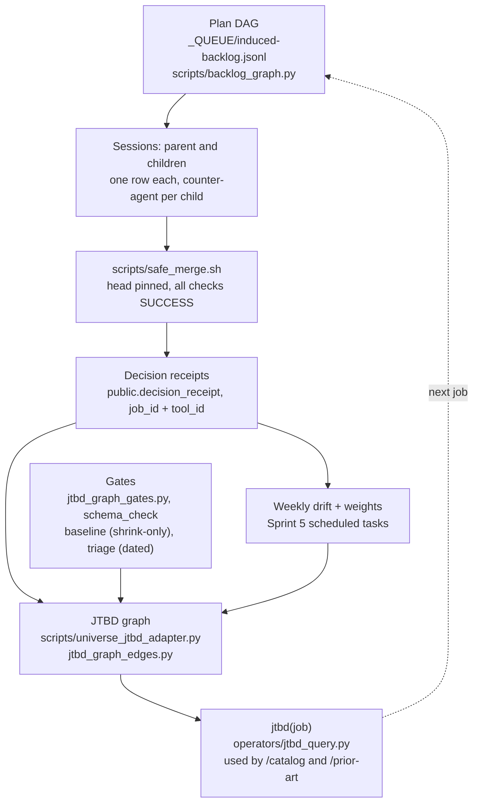

# JTBD system loop: how plan, sessions, merges, receipts and the graph fit together (2026-10-20)

Status: current as of 2026-10-20 (main after PR 1734). Update this file in the same PR as any change to a
layer below (backlog row `jtbd-architecture-note`). Each box names the file or script behind it.

## The layers

| Layer | What it is | Source of truth | Gate |
|---|---|---|---|
| Plan DAG | Backlog rows linked by `depends_on` and `unblocks` | `_QUEUE/induced-backlog.jsonl` | `backlog_status_check.py --check` |
| Session lattice | Parent holds the critical path; each child works one row on its own branch; a counter-agent attacks its exit gate | session briefs; AGENTS.md gotcha 22 (one pusher per branch) | parent verifies in git, not from notes |
| Merge | Merge commits only, head pinned, every check SUCCESS | `scripts/safe_merge.sh` | its `--self-test` |
| Receipts | One row per merge, with `job_id` (the backlog row) and `tool_id` | Supabase `public.decision_receipt` | `receipt_coverage.py` (Sprint 5: >= 70% by 2026-11-03) |
| JTBD graph | Tools, jobs, blockers and deps as stable-id atoms with evidence-backed edges (ADR-089) | generated from the catalogs into `_STATE/jtbd-graph/` | `universe_jtbd_adapter.py --check` (pre-commit) |
| Gates | Zero-tolerance rules; old debt in a shrink-only baseline; new findings only as dated triage holds | `runtime/specs/jtbd-graph-gate-baseline.json`, `runtime/specs/jtbd-graph-triage.json` | TRIAGE-EXPIRED, BASELINE-GREW |
| Retrieval | `jtbd(job)` returns best tool, open blockers, dependency closure, last receipts | `operators/jtbd_query.py` | Sprint 4 blind test: 16/18 vs /catalog 6/18 |
| Feedback | Outcome weights (3+ receipts, promote-only for 30 days) and a weekly read-only drift report | Sprint 5 scripts and scheduled tasks | re-judge 2026-11-17 |

## Rules that keep the loop honest
- Every session gets a backlog row before it starts; its receipt's `job_id` names that row.
- Pre-registered rules change only by dated amendment files, never in place.
- Children report a final sha and stop pushing; merges go through `safe_merge.sh`.
- The graph is graph retrieval over mechanically built, evidence-cited edges, not embedding RAG.
