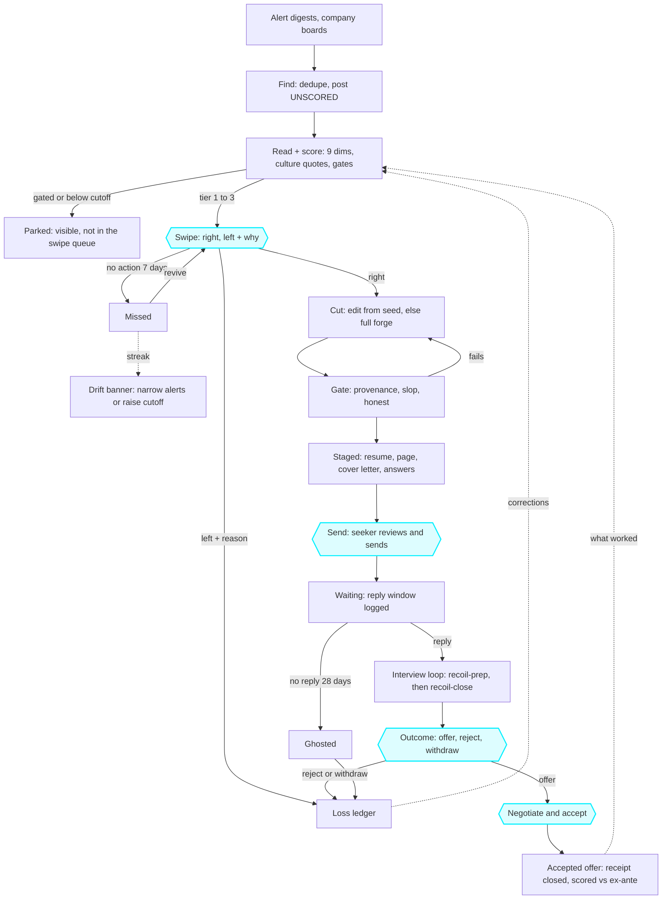

# Job Factory: spec, recommendation, plan

Oct 5, 2026 · @Zach Harris

## The bet

Job Factory is jobs.arcs.care run as a line that needs Zach for only three things: the swipe, the send, and the outcome. Everything else (finding roles, reading the posting, scoring, cutting the resume, staging the page, watching for drift) runs on a schedule and reports back. That is near cruise control in the notomation sense: the system sequences and prepares; it never decides, applies, or speaks for Zach.

**Stays human, always:**

- **Swipe** (right or left, with a reason). The judgment of fit is the revealed preference the system learns from.
- **Send** (any application, email, or note to a counterpart). Draft only; never sent by the system.
- **Outcome** (offer, reject, withdrawn, ghosted). A receipt cannot close itself.

**Done looks like:** on a normal weekday Zach opens the board, swipes the new rows in under ten minutes, and every right swipe already has a resume cut and a staged page waiting. Nothing on the board is invented: every score cites the posting text that produced it.

## Where we are

The line is about two-thirds automated already; the gaps are evidence, engagement, and the back half (apply to outcome). Checked against the repo on 2026-10-05.

| Station | Today | Runs by | Gap |
| --- | --- | --- | --- |
| Find | LinkedIn alert digests parsed from Gmail, deduped, posted UNSCORED; watermark advances | Scheduled task, weekdays 8:15 | One source live; Ashby / Greenhouse adapters proposed, not live |
| Read + score | JD fetched locally, Haiku scores 9 weighted dims (rubric v1.3, max 81), gates checked by regex rules, 25-word assessment | Same task, `jobs_score_sweep.mjs` | **Scores carry no quoted evidence.** Culture is one 0 to 3 number from the model |
| Swipe | Board: right / left with why-tags, undo, tiers, Role Scan per row | Zach | **Unswiped rows age silently**; no missed state, no skip-streak signal |
| Cut | Right swipe queues a forge; edit-from-seed (about 2 cents) before any full forge; cap on concurrency | Same task | Works. Confirm-tier runs ask first |
| Apply + screen | Lane column; moved by hand (PR 754 adds drag and drop) | Zach | No apply-confirmation read from the inbox |
| Interview | Lane column; recoil-prep / recoil-close skills exist | Zach + skills | Not linked from the row |
| Outcome | LaneOutcome + Debrief tab | Zach | n = 2 closed; no reason taxonomy on close |

The September 2025 prototype tried every station at once in the browser and closed none. It is the source for three signals the line lacks: culture cues with evidence, a missed state, and a reason taxonomy for losses.

## The line

Recommendation: run jobs.arcs.care as eight stations, each printing one artifact through one gate, with Zach on exactly three of them.

&#91;embedded content: Job Factory line · 8 stations, 3 human\]

Outcomes and their reasons flow back as corrections that rescore the board, which is how the line learns from real fates instead of seeded guesses.

## The journey, discovery to accepted offer

The seeker spends minutes, not hours, at each human gate; the line spends the hours. Shaded nodes are the seeker's; everything else is the factory. Dashed edges are the learning loops.

**The user flow, step by step**

1. **Morning, 8:15.** New roles arrive scored. The seeker gets one line: how many new, how many above the cutoff, what the cut queue holds.
2. **Swipe (under 10 minutes).** Each card shows the score, the one-line read, and the culture quotes. Right queues a cut; left asks for a reason. Seven days of silence makes it Missed.
3. **Cut (background).** A right swipe produces a resume cut, a page, a cover letter and any application answers. Each passes provenance, slop and honest checks before it is shown.
4. **Weekly press run.** One page: every staged application, go or no-go. The seeker sends; the system never does.
5. **Wait.** The reply window is logged. At 28 days with no reply the row resolves to Ghosted, which is a real outcome, not a loose end.
6. **Interview.** A reply moves the row to the interview lane and unlocks the full forge and recoil-prep for each call.
7. **Outcome.** Offer, reject, or withdraw, each with a reason. The receipt closes and is scored against what the board predicted.
8. **Accept.** The accepted offer closes the search; every correction along the way has already reshaped the rubric for the next one.

## Design spec

Three additions, all in the existing ARCS tokens and inline-style board; no new surface, no new dependency.

**1. Culture lens (evidence on the row).** The culture dimension stops being a bare number. Under each scored row, a one-line strip shows the posting phrases that moved it: green for positive cues (boundaries, parental leave, async, psychological safety, blameless), red for warning cues (hustle, 996, rockstar, always-on, "wear many hats"). Each chip is a quote from the JD, hover shows the sentence. No phrase found reads "no culture signal in the posting", which is not the same as neutral. Role Scan shows the full list.

**2. Missed state + drift banner.** A scored row unswiped for 7 days becomes Missed: dimmed, sorted below live rows, one tap to revive. If the last 3 sessions each left more than half the new rows unswiped, the board shows one calm line: "Rows are piling up faster than you swipe. Narrow the alerts, or raise the cutoff?" with both as buttons. This is the Drift Sentinel for job search: motion without decisions.

**3. Autonomy dial (per station).** Settings gets a small table: each station set to Off, Ask, or Auto. Defaults today: Find Auto, Score Auto, Cut Auto for tiers 1 to 2 and Ask for tier 3, Stage Ask, Send always Off and not settable. The dial is how the factory earns more autonomy one station at a time, by receipt, never by decree.

**Not in this spec:** the sushi belt, 3D, a bandit recommender, and any seeded or synthetic role. The board only ever shows postings that exist.

## Slice 1: culture with evidence

Recommendation: do **not** add vibe and alignment as new dimensions. Rubric v1.3 already has `culture` (weight 3, of 81) and a grind-culture gate. Adding dims would reweight every composite and change every tier. Instead, give the existing culture score mechanical evidence and two guard rails. Composite math is unchanged.

**What changes**

1. **Lexicon in the spec, not the code.** `runtime/specs/target-role-scan.json` gains `culture_cues`: a positive and a negative list, each entry `{id, pattern, label}`, patterns word-bounded (the prototype's `/ai/` matched "said"; never again). Seeded from the 2025 pipeline's cue lists, minus the bare word "must", which fires on almost every posting.
2. **Extraction is a regex pass, not a model call.** In `POST /api/jobs/score`, before the model, scan the JD and keep each hit as the matching sentence (trimmed to 160 characters). Cost: zero tokens.
3. **Stored in the column that already exists.** `jdHits` already holds per-quad keyword hits as TEXT JSON and Role Scan already renders it. Add two keys, `culture_pos` and `culture_neg`. No schema migration.
4. **The model sees the evidence.** The hits ride into the prompt as "culture phrases found", so the 0 to 3 culture score is anchored to quotes, not vibes.
5. **Two guard rails, mechanical.** Two or more negative hits cap `culture` at 1 and add the existing gate "grind-culture red flags in reviews" through `mechanical_gates`. Zero hits either way leaves the model's score as is but the row says "no culture signal in the posting".

**Proof before merge (fails on bad, passes on good)**

- A fixture JD with "fast-paced, wear many hats, rockstar" must gate and cap; a fixture with "parental leave, async, blameless postmortems" must show three green chips; a fixture saying "we maintain a detailed email" must show zero hits (the word-boundary test).
- Run on 20 live rows with `--dry-run`: list every hit and its sentence for Zach to eyeball before any writeback.

**Backfill.** JD text is not stored, so existing rows need a re-fetch. Rescore the top two tiers first (cheap: about 2 cents per 100 rows on Haiku), the rest on the next morning run.

## Implementation plan

Six slices after PR 754, each its own small PR with a receipt, each shippable alone. Order is by leverage per hour; slices 1 and 2 have no dependency on each other.

| # | Slice | Proves done | Size | Depends on |
| --- | --- | --- | --- | --- |
| 0 | Lane kanban drag and drop (PR 754, open) | Card moves between stages on the Vercel preview, signed in as admin | Done in code | None |
| 1 | Culture with evidence | Three fixtures pass; 20-row dry run eyeballed by Zach; composite unchanged on rows with no hits | 1 day | None |
| 2 | Missed state + drift banner | A 7-day-old unswiped row shows Missed; banner appears on a seeded 3-session streak in dev only | 1 day | None |
| 3 | Reason on drop to Outcome | Dropping into Outcome asks fate + reason; writes LaneOutcome; Debrief counts by reason | Half day | 0 |
| 4 | Autonomy dial | Settings table persists Off / Ask / Auto per station; the morning task reads it and obeys | 1 to 2 days | 1, 2 |
| 5 | Second source (Ashby / Greenhouse adapter) | One live company board posts real rows through the same consume path | 1 day | None |
| 6 | Named trust term | Only named people or companies add trust; titles never do; shown as a chip with its source | Half day | 1 |

**Gates on every slice:** `npm run build` clean; the repo's own gates (wrap lint, token source gate); a decision receipt row on merge; nothing synthetic reaches the board.

**Cruise control is reached** when slices 1 to 4 are live and two consecutive weeks of morning runs need no hand fixes. The dial then moves one station from Ask to Auto at a time, each move with its own receipt.

## Decisions for Zach

- [ ] **Slice 1 shape:** evidence on the existing culture dim (recommended) or new vibe and alignment dims that reweight every score?
- [ ] **Guard rail threshold:** two negative phrases cap culture and fire the grind gate. Two, or three?
- [ ] **Missed after how long:** 7 days unswiped (recommended), or 3?
- [ ] **Autonomy defaults:** is Stage (hosting a forge page) Ask, as proposed, or Off until the counterpart responds?
- [ ] **Merge PR 754** once the Vercel preview check passes?
