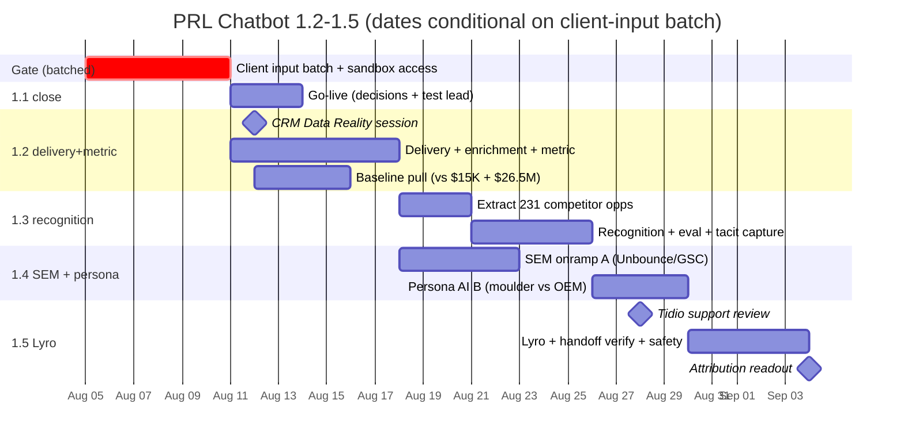

# PRL Chatbot 1.2–1.5 — De-risked Plan: Dependencies, Gantt, Pre-mortem, Phased Pricing
_2026-08-04 · scopes 1.2–1.5 against Zach's three constraints_

## The three constraints this plan is built to satisfy
- **(a) Don't bite off more than I can chew** → phase-gated, sequenced highest-value-first, stop at any
  phase boundary. Never an all-in commit.
- **(b) Don't make Todd more hands-on** → every client input batched into ONE front-loaded packet with
  defaults-on-no-response. After that packet, phases run on Zach-controlled inputs.
- **(c) Don't let costs bubble after the first crack** → FIXED price per phase (not open hours),
  buffer baked in from the pre-mortem, Phase-2 scope explicitly walled off, phase gates cap any
  cascade at a shippable boundary.

**Instrument decision:** fixed-price-per-de-risked-phase, phase-gated. Open hours would bubble on the
first slip; a fixed phase price with a pre-mortem-sized buffer is the cap. The Gantt + pre-mortem is
what makes the fixed number honest.

---

## 1. Dependency map (what blocks what)

```
[Client Input Batch]  ──► 1.1 go-live (3 decisions + sandbox test)
       │                └► 1.2 build (sandbox to write leads)
       │
[CRM Data Reality session] ──► 1.2 metric + baseline  (SM + reports owner; inside the batch)
       │
[231 competitor-tagged opps]* ──► 1.3 recognition + eval   (*INTERNAL, Zach-controlled = low risk)
       │
[Unbounce + GSC/Ads access] ──► 1.4A SEM onramp
       │
[Tidio support review] ──► 1.5 Lyro (cap behavior + handoff verify)   (already requested)
       │
1.2 ──► 1.3 ──► 1.4A ──► 1.4B ──► 1.5   (build sequence; 1.3 can run parallel to 1.4A)
```

Critical path runs through the **Client Input Batch**. Everything else is either Zach-controlled
(1.3 via the 231 opps) or already in motion (Tidio review, territory map done). Front-loading the
batch is the single highest-leverage de-risk.

---

## 2. Gantt (conditional on the input batch returning by ~Aug 11)



If the batch returns fast, the whole of 1.2–1.5 is ~5–6 calendar weeks. If it lags (the 1.1 failure
mode), the gate slips and everything after it slips with it — which is exactly why the batch has a
deadline + defaults (see pre-mortem FM1).

---

## 3. Pre-mortem (most likely failure modes, ranked by likelihood × impact)

| # | Failure mode | Likelihood | Impact | De-risk (built into the plan) |
|---|---|---|---|---|
| **FM1** | **Client-input latency** — decisions/access/sandbox sit for weeks (this IS what happened in 1.1) | High | High | Single batched packet with a **return-by date + pre-declared defaults**: no phone answer → phone required; no lead_source answer → ride "Web Site"; no sandbox → one labelled test lead. Build proceeds on defaults; nothing waits on a reply. Serves (b) and (c). |
| **FM2** | **Vendor surprise** — Tidio 51-conv/mo becomes a hard stop or overage spikes; ZoomInfo per-lookup cost balloons; Mailgun deliverability | Med | High | Confirm the cap behavior in the **pending Tidio support call before Lyro is turned on**; cap ZoomInfo enrichment volume/budget; Mailgun on a dedicated subdomain. Vendor costs are PRL's line, so a spike is visible to Todd, not buried in the fee. |
| **FM3** | **CRM data is worse than hoped** — no captured first-touch, so the 4-hr metric can't be built; $26.5M no-source can't be back-attributed | Med | Med | The **CRM Data Reality session is a GATE**, not an assumption. If first-touch is absent → go-forward proxy (status change), communicated up front. Never fix it by making reps log calls. |
| **FM4** | **Scope creep / cost bubble** — Todd asks for Phase-2 things (voice notes, recommendation engine) mid-stream and the fixed price silently absorbs it | Med | High | **Phase-2 is walled off in writing.** A one-line change-control note: new asks outside 1.2–1.5 are quoted separately. This is the direct answer to (c). |
| **FM5** | **Zach over-commits** — Google/Yuri lands and PRL bandwidth collapses | Med | High | **Phase-gated, 1.2 first.** 1.2 (the metric + attribution, the highest-value piece) ships before anything else, so if Zach has to stop, the most valuable work is already delivered and the exit is clean. Serves (a). |
| **FM6** | **Infra gotchas** — the todd-call route saga, worktree deploy regression, live-site (no staging) breakage | Low | Med | Documented hazards: deploy from main worktree only; staging/sandbox required before touching live; GTM is the controlled go-live switch. |
| **FM7** | **Attribution over-claim** — revenue claimed before the baseline exists, OR realized revenue claimed before the ship-and-collect cycle completes | Med | Med | Baseline pull is a named deliverable inside 1.2; no ROI claim until it lands. **Split two clocks:** report LEADING indicators early (leads captured/qualified/quoted, pipeline, time-to-first-touch) and LAGGING realized-revenue attribution only after deals ship + collect. PRL recognizes closed-won as **realized revenue = cash collected after product ships**, so revenue attribution lags the lead by weeks-to-months. Never present a lead as revenue; present it as pipeline until the cycle closes. |

---

## 4. Phased pricing (fixed per phase, buffer included, gated)

Derived from the de-risked hour estimates (base + pre-mortem buffer) at a blended ~$185/hr. Each
phase is an independent go/no-go; Todd pays only for the phase he greenlights.

| Phase | De-risked effort | Fixed price | Ships (a done-state) |
|---|---|---|---|
| **1.2** delivery + enrichment + 4-hr metric + baseline | ~24h | **$4,500** | Leads land enriched; rep + prospect notified; metric or proxy live; baseline captured |
| **1.3** recognition + eval + tacit capture | ~22h | **$4,000** | Bot recognizes competitor/PRL grades, eval passes, guardrails proven |
| **1.4** SEM onramp (A) + persona-conditional AI (B) | ~32h | **$6,000** | SEM landers open matched onramps; moulder-vs-OEM disclosure works |
| **1.5** Lyro + handoff verify + safety/cap review | ~18h | **$3,500** | AI improv live only after handoff-to-Sugar verified + cap understood |
| **Total 1.2–1.5** | ~96h | **$18,000** | (fixed, phased, stop-anytime) |

Notes:
- **~$18K sits just above the $15K freed lead-gen budget**, because fixed-with-buffer puts overrun
  risk on Zach, not Todd — the small premium is the price of Todd's cost certainty (the thing he
  cares about per constraint c). Still frameable as "your freed lead-gen budget plus a bit, for a
  system you own."
- **Vendor tool costs (Tidio/ZoomInfo/Mailgun) are PRL's, outside this.**
- **Sequencing bias: 1.2 first, 1.4/1.5 last.** Highest value and lowest client-dependency early;
  the vendor-DD-heavy AI work last, behind the Tidio review.

---

## 5. The one client-input batch (front-load this; it is the whole de-risk)

**Present it as a pilot's checklist, not a menu.** Todd is linear/sequential (opens the first link and
works down; never asks which to start with). So this goes to him as a numbered pre-flight checklist
with ONE clear first action and a single return-by date, each item a single action he can knock out in
order. Do NOT hand him five parallel asks to prioritize.

Pre-flight checklist (in order):
1. **Reply with three quick answers** (phone required? / add a "Chatbot" label? / OK to create one
   test lead?). Defaults apply if you would rather I just proceed: require phone, ride "Web Site," one
   labelled test lead.
2. **Forward me SugarCRM sandbox access** (or a yes to the single test lead in step 1).
3. **Pick a 30-minute slot** for me + your sales manager + whoever runs the reports (the data walk).
4. **Tell me who owns the bot day to day** (Nicole?), so I loop them into the Tidio review.
5. **Send Unbounce + Google analytics access** when you get to it (only needed for the SEM step, so
   last).

Everything else runs on Zach-controlled inputs (the 231 opps, the build, the evals) so Todd's list
stays short and ordered.
